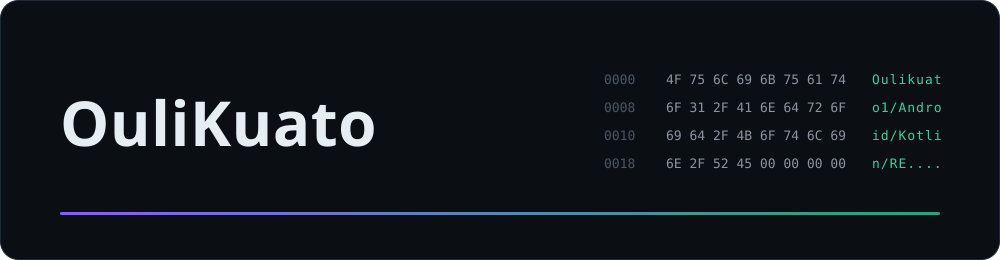

  

## 在做什么

主要做 Android / Jetpack Compose 客户端开发。
也把逆向结果整理成能直接落地的代码，例如 Source2 引擎的结构体偏移快照。
最近在折腾 AI Agent、RAG 与 MCP 工具链。

## 技术栈

  
  
  
  
  
  

## 精选项目

| 项目 | 说明 |
| --- | --- |
| [ex.skill.agent-Napcat](https://github.com/Oulikuato1/ex.skill.agent-Napcat) | NapCat(OneBot v11) + 本地 BM25 倒排索引 RAG + 多模态视听流，拟真 QQ 伴侣 Agent |

## 贡献

<picture>
  <source media="(prefers-color-scheme: dark)" srcset="https://raw.githubusercontent.com/Oulikuato1/Oulikuato1/output/github-contribution-grid-snake-dark.svg">
  <source media="(prefers-color-scheme: light)" srcset="https://raw.githubusercontent.com/Oulikuato1/Oulikuato1/output/github-contribution-grid-snake.svg">
  
</picture>
